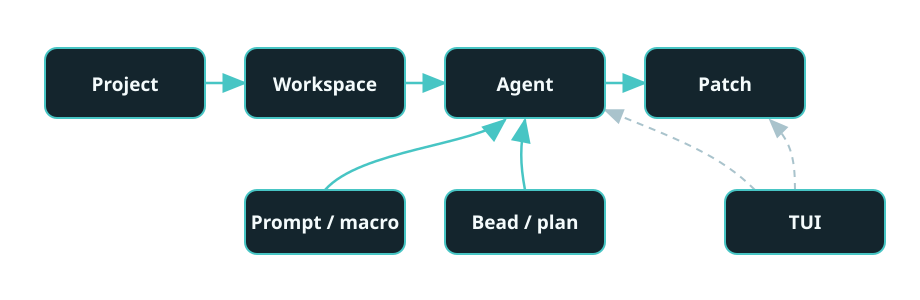

# How SASE works

SASE keeps project work organized around durable records, so agents can work in separate
checkouts and their progress can be followed beyond one chat.

## The seven nouns

1. **Project.** A named body of work that gives SASE a repository and shared settings to
   coordinate.
2. **Workspace.** An isolated checkout where an agent can work without changing another
   agent's files.
3. **Agent.** A delegated worker that receives instructions, works in a workspace, and
   leaves results to review.
4. **Prompt or macro.** A prompt describes the work; a macro reuses instructions for
   work that comes up more than once.
5. **Patch.** A reviewable record that brings a proposed code change and its discussion
   together.
6. **Bead or plan.** A bead tracks a unit of work; a plan describes an approach and can
   organize related work.
7. **TUI.** SASE's terminal interface brings work, records, and agent progress into one
   place.

## Where next

- [Agents, sessions, and workspaces](agents.md) — how delegated work runs and continues.
- [Work units](work-units.md) — how outcomes, plans, beads, and review records fit
  together.
- [How changes land](landing.md) — how reviewed work reaches a version-control system.
